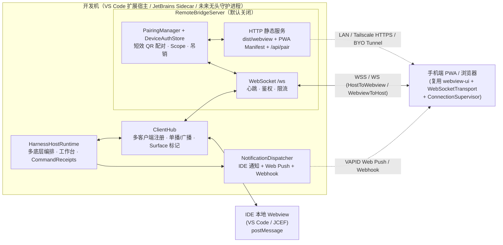
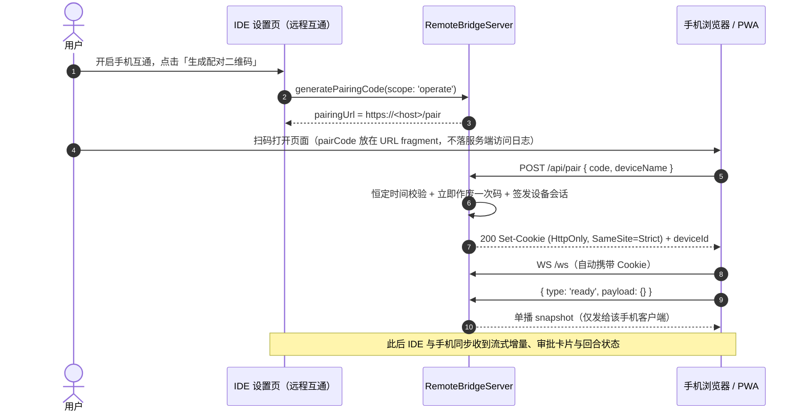

# 手机端互通方案

> 状态：方案设计与实践计划 ｜ 日期：2026-11-21
>
> 相关文档：[改进路线图](../ROADMAP.md)（M5 手机端互通 `HD-22`–`HD-28`）｜ [整体架构](./DESIGN.md)

---

## 1. 架构原则与设计目标

手机端互通的核心原则是「瘦客户端 + 宿主机唯一执行边界」：手机端永远不碰本地代理进程或项目文件，所有执行与安全边界严格留在开发机（Host）侧，多端共用同一套协议与连接状态机，避免状态分叉。

- **三层网络连通**：局域网直连（LAN）→ 私有组网（Tailscale HTTPS/WSS）→ 自带隧道（BYO Tunnel）。
- **安全与配对模型**：宿主自主颁证、短效一次性配对码/二维码、作用域最小化（`read-only` / `operate`）、已授权设备管理与即时吊销。
- **实时同步与断线恢复**：快照水合 + 增量事件同步 + 单一重试所有权的连接监督器（指数退避 + 切回前台健康探测）。
- **移动端专属体验**：安全区与虚拟键盘适配、Webview 内置 Diff 审阅、多行输入与附件、Web Push / Webhook 通知与桌面活跃时静默抑制。

---

## 2. Halo 的现状评估：哪些已有、哪些要补

Halo 当前已完成 M0–M4（`HD-01`–`HD-21`），架构上天然具备极高的移动端互通复用度：

### 2.1 可直接复用的现有资产

| 现有模块 | 路径 | 对手机端互通的价值 |
| --- | --- | --- |
| 宿主核心运行时 | `packages/extension/src/host/HarnessHostRuntime.ts` | 已通过 `HostPlatform` 与 VS Code / JetBrains 完全解耦，可直接挂接远程桥接服务 |
| 强类型双向协议 | `packages/shared/src/bridge.ts` | 全量 `WebviewToHost`（Zod 校验）与 `HostToWebview`（`HostSnapshot` + `ItemsPatch`）已就绪 |
| 幂等命令回执 | `packages/extension/src/host/receipts.ts`（HD-16） | `sendMessage` / `respondApproval` / `answerQuestion` / `runScheduleNow` 已带 `commandId` 5 分钟去重，天然防弱网重试重复执行 |
| 多视图广播模式 | `packages/extension/src/webview/ChatViewProvider.ts` | 已同时向侧边栏与全宽工作台面板推送同一状态流，易于演进为多客户端总线 |
| 前端 UI 与传输边界 | `packages/webview-ui/src/vscode.ts`（58 行） | 整个 React 前端（含 `shadcn-ui`、`beautifului`、中英文、主题、`use-mobile.ts`）仅通过这一个文件依赖宿主通道 |
| 通知调度器 | `packages/extension/src/notifications/NotificationService.ts` | 已统一抽象 `attention` / `turnComplete` / `unexpectedExit` / `scheduledComplete`、去重与 `isWindowFocused()` 静默判断 |
| 无头常驻能力 | `packages/extension/src/sidecar/headlessScheduler.ts`（HD-18） | 已验证脱离 IDE 运行 `HarnessHostRuntime` 与单实例锁，可作为未来常驻守护进程底座 |
| 依赖现成 | `packages/extension/package.json` | `ws`、`zod`、`diff` 均已内置，无需引入重型框架 |

### 2.2 必须解决的关键缺口与陷阱

1. **单播 vs 广播未分离**：当前 `HarnessHostRuntime` 收到 `ready` 会通过 `platform.postToWebview` 向所有视图广播完整 `snapshot`；手机弱网频繁重连时，必须**仅向新连接/重连的单个客户端单播快照**，绝不能刷掉桌面 IDE 视图。同时，`fileCandidates`、`markdownPreview`、`diffContent`、`quotaFetched`、`restoreDraft` 等请求级响应也应按 `clientId` 定向回传。
2. **依赖 IDE 弹窗与 Diff 编辑器的交互**：
   - `openDiff` / `openSourceControlDiff` / `previewApproval` 目前调用 `vscode.diff` 或 IDEA Diff 编辑器，手机端必须改由宿主下发 Diff 数据并在 Webview 内直接渲染。
   - `workbench.confirm()` / `workbench.input()` / `pickOpenDialog()`（用于 `danger-full-access`、回合回滚、`renameSession`、`createWorktree`、`removeWorktree`、`pickFiles` 等）若由手机触发却弹在电脑 IDE 上，会造成手机端静默卡死。必须区分 `clientSurface: 'ide' | 'mobile-web'`，手机端统一使用 Webview 内 `Dialog` 完成确认与输入，IDE 专属能力按端能力降级或隐藏。
3. **无外网中继基础设施前提**：Halo 是开源 IDE 插件，**不自建 Clerk / Cloudflare 商业账号中继，也不在首期背负 App Store / Google Play 原生客户端审核与维护成本**。

---

## 3. 架构选型

| 维度 | Halo 实践选型 | 理由 |
| --- | --- | --- |
| 手机客户端形态 | **PWA 移动 Web 优先**（直接复用 `packages/webview-ui`）；保持协议开放，后续按需套壳 | 零商店审核、零双套 UI 维护；新底层/新能力（`capabilities.ts`）零成本同步到手机 |
| 宿主运行形态 | **阶段一：IDE 内嵌桥接（VS Code & JetBrains 共享）**；**阶段二：扩展 HD-18 为脱离 IDE 的独立守护进程** | 阶段一立刻实现「IDE 面板 ↔ 手机」同会话实时无缝接力，零额外后台进程管理负担 |
| 网络连通 | **LAN 局域网直连（MVP）→ Tailscale 一键 HTTPS 接入 → BYO 自带隧道（`cloudflared` / `frp` / 反代）** | 零云端运维成本、100% 隐私可控；Tailscale HTTPS 同时解锁 PWA 完整能力与免中继 Web Push |
| 认证与配对 | **QR 短效一次配对码（5 分钟）+ `HttpOnly` Cookie/设备令牌 + 作用域（`read-only` / `operate`）+ 已授权设备管理与即时吊销** | 完整覆盖威胁模型，且无需在浏览器端引入过度复杂的外部身份提供商 |
| 状态同步 | **沿用现有 `HostSnapshot` + `ItemsPatch` + `commandId` 幂等回执 + `ConnectionSupervisor` 断线重连** | 改动面最小，不重写控制器与投影层 |
| 推送通知 | **宿主直连 Web Push（本地 VAPID，HTTPS PWA 生效）+ 通用 Webhook（Bark/ntfy/IM，LAN HTTP 兜底）+ 桌面活跃静默** | 无需自建推送服务器；覆盖 iOS 16.4+ PWA、Android Chrome 与局域网全部场景 |

---

## 4. 目标架构图与数据流

### 4.1 总体架构

### 4.2 配对与连接时序

### 4.3 安全红线（强制约束）

1. **默认关闭、显式开启**：未开启时零监听端口；关闭总开关立即断开所有远程 WS 并释放监听端口。
2. **绝不把长期令牌放进 URL 查询参数**：配对二维码仅携带 5 分钟单次有效 `pairCode`，并放在 `#fragment` 中避免泄露到代理日志或 Referer；交换后的长期凭据通过 `HttpOnly` Cookie 下发。
3. **防 DNS Rebinding 与暴力破解**：严格校验 `Host` / `Origin` 白名单；`/api/pair` 实施失败计数退避与锁定（如 5 次失败自动作废当前配对码）。
4. **敏感操作远程默认禁止（Scope Guard）**：
   - `read-only` 作用域：仅允许 `ready`、`loadOlder`、`openDiff`（内嵌查看）、`previewMarkdown`、`refreshSourceControl`、`switchSession`、`activateTab`、`markUnreadRead` 等只读操作，拒绝一切写操作。
   - `operate` 作用域：允许对话发送、中断、审批/提问回答、模型/权限切换、源码控制提交/推送/PR、工作台任务/定时操控；**默认屏蔽高危宿主机配置变更**（`installBackend`、`uninstallBackend`、`upsertBackendProfile`、`deleteBackendProfile`、`upsertProvider`、`deleteProvider`、`upsertMcpServer`、`deleteMcpServer`、`configureApiKey`、`setPreferences.advanced`），必须回到本机 IDE 操作。
5. **所有状态变更保留幂等保护**：远程客户端沿用 `HD-16` 的 `commandId` 机制，防止弱网重连导致重复发送或重复批准命令。

---

## 5. 分阶段实践路线（对应 `ROADMAP.md` M5）

| 阶段 | 编号 | 交付物 | 可验证里程碑 |
| --- | --- | --- | --- |
| **Phase 1：地基** | `HD-22` | `ClientHub` 多端单播/广播总线 + Webview `Transport` 抽象 + `ConnectionSupervisor` | 浏览器直接连本地 mock/WS 跑通全套对话流，IDE 端零回归 |
| **Phase 2：局域网 MVP** | `HD-23`、`HD-24`、`HD-25` | 宿主 HTTP/WS 桥 + QR 扫码配对与设备管理 + 手机端响应式/PWA + 内嵌 Diff 与无 IDE 弹窗降级 | **同一 Wi-Fi 下手机扫码即连 VS Code / JetBrains**：实时看流式输出、审批命令、看 Diff、发新任务、一键吊销设备 |
| **Phase 3：跨网与推送** | `HD-26`、`HD-27` | Tailscale 自动探测与一键 HTTPS 接入 + BYO 隧道支持 + VAPID Web Push & Webhook 推送（桌面活跃静默） | **离开工位用 5G 也能连回开发机**；Agent 等审批或跑完回合时手机收到推送，点开直接处理 |
| **Phase 4：离线常驻（按需）** | `HD-28` | `sidecar.cjs --headless-server` 脱离 IDE 常驻服务与平滑交接 | 关掉电脑上的 IDE 后，手机仍可继续访问项目与会话 |

---

## 6. 跨端改动自检对照（对照 `AGENTS.md` 8 条清单）

实施 M5 每一项时需同步核对：

1. **入口**：设置页「远程互通」Tab + 命令面板命令（开启/关闭远程互通、生成配对码、查看已连接设备）+ 状态栏远程连接数指示。
2. **客户端**：VS Code Extension Host、JetBrains Sidecar（`server.ts`）、移动端 PWA Webview 三端一致。
3. **底层**：手机端互通运行在 `HarnessHostRuntime` 与 `HostToWebview` 之上，对 dsh / Claude / Pi / ZCode / Codex / CodeBuddy / ACP **全底层透明通用**；各底层能力差异继续由 `packages/shared/src/capabilities.ts` 驱动。
4. **契约**：`packages/shared/src/bridge.ts` 与 `viewModel.ts` 同步新增远程状态（`remote`）、内嵌 Diff 内容（`diffContent`）及配对/设备管理消息。
5. **反向状态**：开启远程必配急停关闭；扫码配对必配设备列表与单设备一键吊销；开启推送必配退订与静默开关。
6. **语言**：`packages/extension/src/i18n.ts` 与 `packages/webview-ui/src/i18n.ts` 中英文同步补齐并通过 `pnpm check:i18n`。
7. **文档**：用户使用与 Tailscale/隧道配置步骤写入 `packages/extension/README.md`；架构边界更新本文件与 `ROADMAP.md`。
8. **测试**：单测覆盖配对码生命周期/限流/Scope 守卫/`ConnectionSupervisor` 退避状态机；集成测试起真实 HTTP+WS 桥断言「配对 → WS 建连 → 单播快照 → 双端同步审批 → 吊销断连」全链路；移动端视口（390×844）补布局验证。
